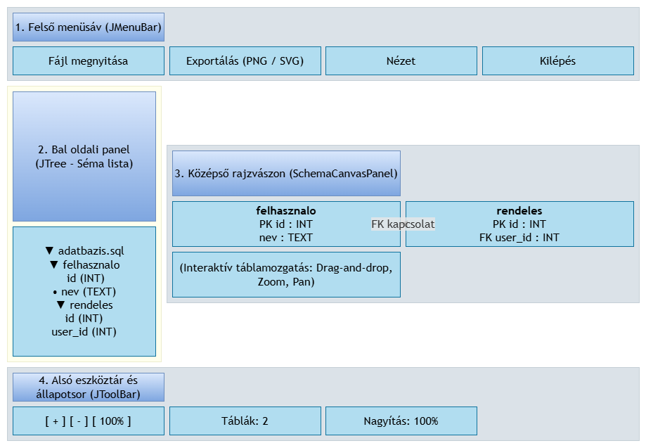
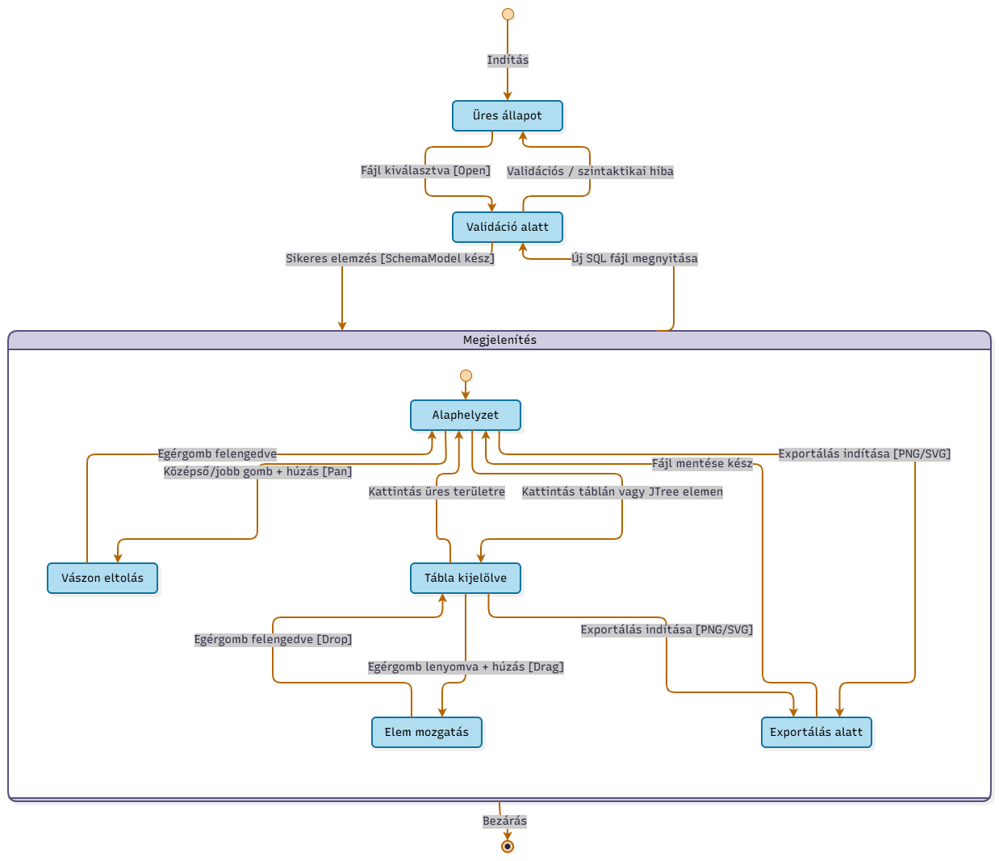

# Felhasználói felület és rendszerterv

Ez a dokumentum bemutatja az adatbázis-séma elemző és vizualizáló alkalmazás grafikus felépítését, komponens-architektúráját, működési folyamatait, állapotátmeneteit, hibakezelési stratégiáját és vizuális specifikációját.

---

## 1. A felület felépítése és komponens-architektúra

Az alkalmazás főablaka egy `JFrame` keretben, modern **FlatLaf** megjelenéssel épül fel. Az elrendezés `BorderLayout` és `JSplitPane` konténerekre támaszkodik, hogy az ablak átméretezésekor a munkaterület dinamikusan alkalmazkodjon.

*1. ábra: A főablak elrendezése és főbb komponensei*

### A főbb felületi elemek specifikációja

| Azonosító | Swing komponens | Feladat és működés |
| :--- | :--- | :--- |
| **1. Felső menüsáv** | `JMenuBar` (`JMenu`, `JMenuItem`) | Központi vezérlőpont billentyűparancsokkal: SQL fájl megnyitása (`Ctrl+O`), diagram exportálása PNG/SVG formátumba (`Ctrl+E`), vászon visszaállítása (`Ctrl+0`), kilépés. |
| **2. Bal oldali panel** | `JTree` (`DefaultTreeModel`) | Hierarchikus áttekintést nyújt a betöltött `SchemaModel` objektumról. Gyökéreleme az adatbázis/fájl neve, alatta a táblák (`Table`), azokon belül pedig az attribútumok (`Column`) típus- és kulcsjelöléssel. Egy táblára kattintva a vászon automatikusan arra a csomópontra fókuszál és kijelöli azt. |
| **3. Középső rajzvászon** | Egyedi `JPanel` (`Graphics2D`) | A fő vizuális munkaterület. Saját `paintComponent(Graphics g)` metódussal rajzolja ki a rácsos hátteret, a táblákat és az idegen kulcs kapcsolatokat. Az egérműveleteket `MouseListener`, `MouseMotionListener` és `MouseWheelListener` kezeli. |
| **4. Alsó eszköztár** | `JToolBar` + `JLabel` | Gyorsgombok a nagyításhoz (Zoom In / Out), az alapértelmezett 100%-os nézet visszaállításához, valamint egy állapotsor a betöltött táblák számának és az aktuális nagyítási aránynak a kijelzésére. |

---

## 2. Működési folyamat és állapotmodell

A rendszer működését tervezési szempontból két külön nézetben vizsgáljuk: a **felhasználói munkafolyamat** (aktivitási diagram) a használat lépéseit, míg az **alkalmazás állapotgépe** (állapotdiagram) szigorúan a szoftver belső állapotait és az azokat kiváltó eseményeket írja le.

### 2.1. Felhasználói munkafolyamat (Aktivitási diagram)

A program indításától az exportálásig terjedő tipikus használati folyamat:

*2. ábra: A séma betöltésének és szerkesztésének munkafolyamata*

### 2.2. Az alkalmazás állapotdiagramja (State Machine)

Az alábbi diagram kizárólag a rendszer belső állapotait és a felhasználói/rendszeresemények hatására bekövetkező állapotátmeneteket ábrázolja:

*3. ábra: A felhasználói felület és a vászon állapotdiagramja*

### 2.3. Grafikus transzformáció és élrajzolási logika

* **Vászon transzformáció (`AffineTransform`):** A nagyítás (zoom) és az eltolás (pan) nem módosítja a táblák logikai koordinátáit; a `Graphics2D` kontextusra alkalmazott transzformációs mátrix végzi a leképzést, így az SVG és PNG exportálás mindig az eredeti, torzításmentes koordinátákból dolgozik.
* **Dinamikus kapcsolat-illesztés:** Két tábla között húzódó idegen kulcs (`FK`) kapcsolat esetén a rendszer a két téglalap középpontjának relatív helyzetéből számítja ki, hogy a csatlakozási pont a dobozok melyik oldalára (felső, alsó, bal vagy jobb él közepére) essen, így vonszolás közben a vonalak folyamatosan követik a táblákat.

---

## 3. Hibakezelési stratégia

A rendszer a bemeneti fájlok feldolgozása és a fájlműveletek során védekező (*defensive*) megközelítést alkalmaz. Hiba esetén a korábban betöltött érvényes séma (ha volt) nem sérül.

| Hiba kategóriája | Kiváltó ok | Detektálás helye | Rendszer reakciója és felhasználói visszajelzés |
| :--- | :--- | :--- | :--- |
| **Fájlkezelési hiba** | Nem létező fájl, jogosultsági hiány, üres (0 bájtos) fájl. | I/O réteg (`Files.readString`) | `JOptionPane.ERROR_MESSAGE` ablak a pontos I/O hibaok megjelölésével; a vászon állapota változatlan marad. |
| **Biztonsági / tiltott utasítás** | Kártékony vagy nem DDL jellegű SQL kulcsszavak (pl. `DROP`, `DELETE`, `UPDATE`, `EXEC`, `ATTACH`) jelenléte. | Előszűrő / Lexer validátor | A feldolgozás azonnal megszakad; figyelmeztető párbeszédablak jelenik meg a tiltott kulcsszó és a sorszám megjelölésével. |
| **Szintaktikai hiba** | Hibás `CREATE TABLE` szerkezet, lezáratlan zárójel vagy hiányzó adattípus. | Szintaktikai elemző (Parser) | Strukturált `ParseException` dobása sor- és oszlopszámmal, amelyet a UI egy modális hibaablakban jelenít meg. |
| **Szemantikai inkonzisztencia** | Az `FK` hivatkozás olyan táblára vagy oszlopra mutat, amely nem szerepel a fájlban. | Modellépítő (SchemaBuilder) | Figyelmeztetés megjelenítése a státuszsorban; a létező táblák kirajzolásra kerülnek, a hiányzó hivatkozás pedig nem okoz `NullPointerException`-t. |
| **Üres séma** | Szintaktikailag helyes fájl, de nem tartalmaz `CREATE TABLE` utasítást. | Parser kimenet ellenőrzés | Információs üzenet (`INFORMATION_MESSAGE`): *„A kiválasztott fájl nem tartalmaz megjeleníthető tábladefiníciót.”* |
| **Exportálási hiba** | Írásvédett célkönyvtár vagy megtelt háttértár PNG/SVG mentéskor. | Export modul | Hibaablak a fájlrendszeri hiba leírásával; a szerkesztett vászonállapot megmarad, a mentés újrapróbálható. |

---

## 4. Látványvilág és vizuális specifikáció

A felület célja a magas kontrasztú, jól olvasható és dokumentációba közvetlenül beilleszthető diagramok előállítása.

* **Téma és tipográfia:**
  * Az ablak kerete és vezérlői a **FlatLaf** (*FlatLightLaf* / *FlatDarkLaf*) témát használják.
  * A táblanevek megjelenítéséhez félkövér, a mezőnevekhez és adattípusokhoz pedig egyenletes karakterközű vagy jól tagolt sans-serif betűtípus (`Segoe UI` / `SansSerif`, 12–14 pt) tartozik.
* **Tábladobozok (`TableNode`) vizuális felépítése:**
  * Lekerekített sarkú, vékony kerettel ellátott téglalap, amely két fő zónára oszlik:
    1. **Fejléc:** Kiemelt háttérszínnel ellátott sáv, amely középre igazítva tartalmazza a tábla nevét.
    2. **Attribútumlista:** Soronként megjeleníti a mező kulcs-státuszát, nevét és adattípusát.
* **Kulcsok és megkötések jelölése:**
  * **Elsődleges kulcs (`PK`):** Kiemelt színű jelvény vagy ikon és **félkövér** mezőnév.
  * **Idegen kulcs (`FK`):** Elkülönülő színű jelvény és *dőlt* vagy aláhúzott jelölés, hogy vizuálisan azonnal azonosítható legyen a kapcsolat kiindulópontja.
  * **Kötelező mező (`NOT NULL`):** Csillag (`*`) vagy halványított jelzőcímke a típus mellett.
* **Kapcsolati élek (`RelationEdge`):**
  * Simított élsimítással (`RenderingHints.KEY_ANTIALIASING`) rajzolt irányított vonalak, amelyek a hivatkozó táblától (`FK`) a hivatkozott tábla (`PK`) felé mutató nyílheggyel végződnek. Kijelöléskor a kapcsolódó táblák és az őket összekötő vonalak kiemelt keretszínt kapnak.