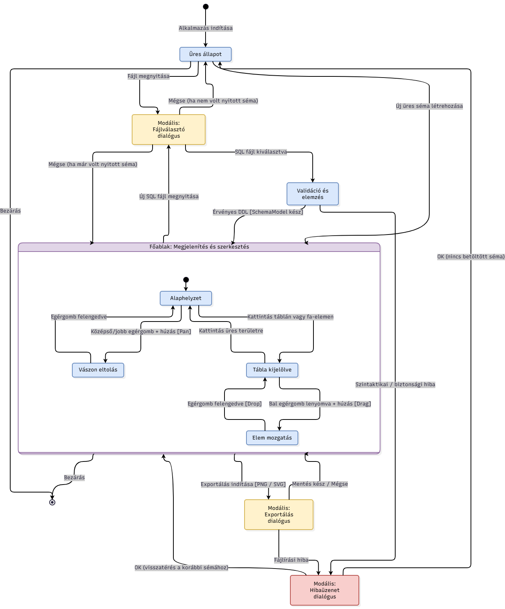
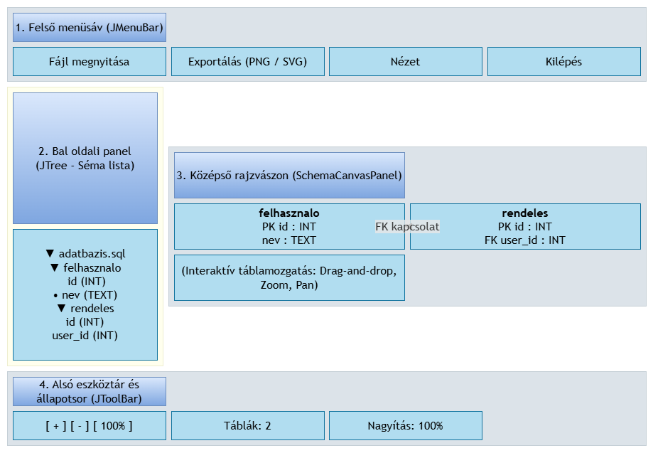

# Felhasználói felület és rendszerterv

Ez a dokumentum bemutatja az adatbázis-séma elemző és vizualizáló alkalmazás funkcionális felületi felépítését, működési folyamatait, állapotátmeneteit, hibakezelési stratégiáját, valamint a Java Swing alapú tervezési és vizuális specifikációját.

---

## 1. Felületi áttekintés (Specifikációs nézet)

Az alkalmazás egyetlen elsődleges főablakra épül, amely négy jól elkülöníthető funkcionális zónára oszlik. A felhasználó az indítást követően azonnal választhat egy meglévő SQL sémafájl megnyitása vagy egy új, üres munkaterület létrehozása között.

*1. ábra: A főablak funkcionális elrendezése*

- **1. Felső menüsáv:** Központi vezérlőpont az alapvető fájlműveletekhez és nézetváltásokhoz: új üres séma indítása, meglévő SQL fájl megnyitása (`Ctrl+O`), a diagram exportálása PNG vagy SVG formátumba (`Ctrl+E`), nézet visszaállítása (`Ctrl+0`), valamint az alkalmazás bezárása.
- **2. Bal oldali sémastruktúra-panel:** Hierarchikus fastruktúrában jeleníti meg a betöltött adatbázis tábláit és azok attribútumait (adattípusokkal és kulcsjelölésekkel). Egy tábla kiválasztásakor a rajzvászon automatikusan arra az elemre fókuszál.
- **3. Középső interaktív rajzvászon:** A relációs séma vizuális szerkesztőfelülete, ahol a táblák szabadon mozgathatók (drag-and-drop), a nézet pedig nagyítható (zoom) és eltolható (pan).
- **4. Alsó eszköztár és állapotsor:** Gyors nagyítási vezérlőket (`+`, `-`, `100%`), valamint valós idejű összegző információkat (betöltött táblák száma, aktuális nagyítási arány) és nem blokkoló figyelmeztetéseket jelenít meg.

---

## 2. Működési folyamat és állapotmodell

A rendszer működését két nézetben modellezzük: a **felhasználói munkafolyamat** (aktivitási diagram) a használat lépéseit és elágazásait, míg az **alkalmazás állapotgépe** (állapotdiagram) a főablak és a modális párbeszédablakok pontos állapotátmeneteit írja le.

### 2.1. Felhasználói munkafolyamat (Aktivitási diagram)

Az alkalmazás indításától a leállításáig tartó munkafolyamatot a 2. ábra szemlélteti. A diagram tartalmazza az új és meglévő fájlokkal való indítási lehetőségeket, a validációs döntési pontokat, valamint a szerkesztés közben bármikor, aszinkron módon kezdeményezhető exportálást:

*2. ábra: A séma betöltésének, validálásának és szerkesztésének munkafolyamata*

> **Megjegyzés a validációhoz („nem engedélyezett SQL”):** Mivel az alkalmazás célja a relációs adatbázis-sémák biztonságos megjelenítése, a bemeneti fájlok ellenőrzése során kizárólag adatdefiníciós (DDL – `CREATE TABLE`, `ALTER TABLE`) utasítások engedélyezettek. Az adatmanipulációs (`INSERT`, `UPDATE`, `DELETE`), destruktív (`DROP`, `TRUNCATE`) vagy rendszervezérlő (`EXEC`, `ATTACH`) parancsokat a validátor nem engedélyezett utasításként elutasítja.

### 2.2. Az alkalmazás állapotdiagramja (State Machine)

Mivel az alkalmazás egyetlen főablakra épül, a fájlműveletek, az exportálás és a hibajelzések **modális párbeszédablakokon** keresztül történnek, amelyek megjelenésükkor átmenetileg blokkolják a főablakot. A rendszer belső állapotait és a modális ablakok átmeneteit a 3. ábra rögzíti:

*3. ábra: A főablak és a modális párbeszédablakok állapotdiagramja*

---

## 3. Hibakezelési stratégia és folyamatbeli integráció

A rendszer a bemeneti fájlok feldolgozása és az exportálás során védekező (*defensive*) megközelítést alkalmaz. A kritikus hibák a **2. ábra** validációs és mentési pontjain kerülnek elkapásra, és a **3. ábrán** látható `Modális: Hibaüzenet dialógus` állapotba vezetik a rendszert, miközben a korábban betöltött érvényes séma (ha volt) sértetlen marad.

| Hiba kategóriája | Folyamatbeli hely (2. és 3. ábra) | Kiváltó ok és detektálás | Felületi megjelenés és rendszerreakció |
| :--- | :--- | :--- | :--- |
| **Fájlkezelési hiba** | *SQL fájl kiválasztása* $\rightarrow$ *Validáció* (`FajlValasztoModal` $\rightarrow$ `HibaModal`) | Nem létező fájl, jogosultsági hiány vagy üres (0 bájtos) fájl az I/O rétegben (`Files.readString`). | **Modális hibaablak** (`JOptionPane.ERROR_MESSAGE`) a pontos I/O hibaok megjelölésével; visszaáll az előző állapot. |
| **Nem engedélyezett SQL utasítás** | *Érvényes a fájl és csak DDL-t tartalmaz?* (`[Nem]` ág $\rightarrow$ `HibaModal`) | Nem DDL jellegű vagy destruktív SQL parancs (pl. `DROP`, `DELETE`, `INSERT`, `UPDATE`, `EXEC`) az előszűrőben. | **Modális hibaablak** blokkolja a betöltést a nem támogatott kulcsszó és sorszám megjelölésével; a korábbi séma megmarad. |
| **Szintaktikai hiba** | *Érvényes a fájl és csak DDL-t tartalmaz?* (`[Nem]` ág $\rightarrow$ `HibaModal`) | Hibás `CREATE TABLE` szerkezet, lezáratlan zárójel vagy hiányzó adattípus a Parserben (`ParseException`). | **Modális hibaablak** sor- és oszlopszámmal; részleges vagy hibás modell nem kerül kirajzolásra. |
| **Üres séma** | *Érvényes a fájl és csak DDL-t tartalmaz?* (`[Nem]` ág $\rightarrow$ `HibaModal`) | Szintaktikailag helyes fájl, de nem tartalmaz `CREATE TABLE` utasítást (Parser kimenet ellenőrzése). | **Modális információs ablak** (`INFORMATION_MESSAGE`): *„A kiválasztott fájl nem tartalmaz megjeleníthető tábladefiníciót.”* |
| **Szemantikai inkonzisztencia** | *Séma feldolgozása és modell felépítése* (a `Megjelenites` állapotba lépéskor) | Az `FK` hivatkozás nem létező táblára vagy oszlopra mutat a `SchemaBuilder` fázisban. | **Nem blokkoló figyelmeztetés az alsó állapotsorban**; a létező táblák kirajzolódnak, a hiányzó hivatkozás nem okoz futásidejű hibát. |
| **Exportálási hiba** | *Mentés PNG vagy SVG formátumban* (`ExportModal` $\rightarrow$ `HibaModal`) | Írásvédett célkönyvtár vagy megtelt háttértár PNG/SVG mentéskor az Export modulban. | **Modális hibaablak** a fájlrendszeri hiba leírásával; a vásznon lévő diagram állapota nem vész el, a mentés újrapróbálható. |

---

## 4. Tervezési architektúra és vizuális specifikáció

### 4.1. Java Swing komponens-architektúra

Az alkalmazás főablaka egy `JFrame` keretben, modern **FlatLaf** megjelenéssel épül fel. Az elrendezés `BorderLayout` és `JSplitPane` konténerekre támaszkodik, hogy az ablak átméretezésekor a munkaterület dinamikusan alkalmazkodjon.

*4. ábra: A főablak Java Swing komponens-architektúrája*

| Felületi zóna | Swing komponens | Implementációs feladat |
| :--- | :--- | :--- |
| **Felső menüsáv** | `JMenuBar` (`JMenu`, `JMenuItem`) | Menüpontok és gyorsbillentyűk (`Ctrl+N`, `Ctrl+O`, `Ctrl+E`, `Ctrl+0`) eseménykezelése. |
| **Bal oldali panel** | `JTree` (`DefaultTreeModel`) | A `SchemaModel` hierarchikus leképezése (`Adatbázis` $\rightarrow$ `Table` $\rightarrow$ `Column`) és kijelölés-szinkronizálás a vászonnal. |
| **Középső rajzvászon** | `SchemaCanvasPanel` (`JPanel`) | Egyedi `paintComponent(Graphics g)` rajzolás `Graphics2D` segítségével; `MouseListener`, `MouseMotionListener` és `MouseWheelListener` kezelése. |
| **Alsó eszköztár** | `JToolBar` + `JLabel` | Nagyítási vezérlők, táblaszámláló és a nem blokkoló figyelmeztetések megjelenítése. |

### 4.2. Grafikus transzformáció és élrajzolási logika

- **Vászon transzformáció (`AffineTransform`):** A nagyítás (zoom) és az eltolás (pan) nem módosítja a táblák logikai koordinátáit; a `Graphics2D` kontextusra alkalmazott transzformációs mátrix végzi a leképzést, így az SVG és PNG exportálás mindig az eredeti, torzításmentes koordinátákból dolgozik.
- **Dinamikus kapcsolat-illesztés:** Két tábla között húzódó idegen kulcs (`FK`) kapcsolat esetén a rendszer a két téglalap középpontjának relatív helyzetéből számítja ki, hogy a csatlakozási pont a dobozok melyik oldalára (felső, alsó, bal vagy jobb él közepére) essen, így vonszolás közben a vonalak folyamatosan követik a táblákat.

### 4.3. Látványvilág és jelölésrendszer

- **Téma és tipográfia:** A vezérlők a **FlatLaf** (*FlatLightLaf* / *FlatDarkLaf*) témát használják. A táblanevek félkövér, az attribútumok és adattípusok jól tagolt sans-serif betűtípussal (`Segoe UI` / `SansSerif`, 12–14 pt) jelennek meg.
- **Tábladobozok (`TableNode`):** Lekerekített sarkú, vékony kerettel ellátott téglalapok, amelyek kiemelt háttérszínű fejlécre és soronként tagolt attribútumlistára oszlanak.
- **Kulcsok és megkötések:**
  - **Elsődleges kulcs (`PK`):** Kiemelt színű jelvény és **félkövér** mezőnév.
  - **Idegen kulcs (`FK`):** Elkülönülő színű jelvény és *dőlt* vagy aláhúzott jelölés.
  - **Kötelező mező (`NOT NULL`):** Csillag (`*`) vagy halványított jelzőcímke a típus mellett.
- **Kapcsolati élek (`RelationEdge`):** Élsimítással (`RenderingHints.KEY_ANTIALIASING`) rajzolt irányított vonalak, amelyek a hivatkozó táblától (`FK`) a hivatkozott tábla (`PK`) felé mutató nyílheggyel végződnek. Kijelöléskor a kapcsolódó táblák és élek kiemelt keretszínt kapnak.