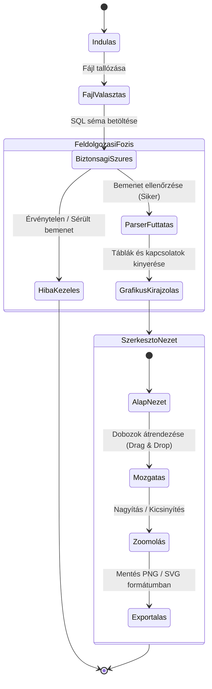

# Felhasználói felület és működés

Ez a dokumentum bemutatja az adatbázis-séma elemző és vizualizáló alkalmazás grafikus felépítését, működési logikáját, hibakezelési elveit és látványvilágát.

## 1. A felület felépítése

Az alkalmazás egy asztali ablak (Java Swing alapokon, FlatLaf modern megjelenéssel), amely a következő főbb részekből áll:

```text
+-------------------------------------------------------------+
| [1] Felső menüsáv (Fájl megnyitása, Exportálás, Kilépés)    |
+---------------------+---------------------------------------+
|                     |                                       |
|  [2]                |          [3] Rajzvászon (Diagram)     |
|  Bal oldali panel   |          (Interaktív dobozok és       |
|  (Séma fastruktúra) |           összekötő nyilak,           |
|                     |           drag-and-drop mozgatás)     |
|                     |                                       |
+---------------------+---------------------------------------+
|  [4] Eszköztár (Nagyítás, kicsinyítés, alapállapot)         |
+-------------------------------------------------------------+
```

* **[1] Felső menüsáv:** Itt érhetők el az alapvető funkciók (Fájl megnyitása, Exportálás PNG/SVG formátumba, Kilépés).
* **[2] Bal oldali panel (Séma lista):** Egy fastruktúra, amely kilistázza a beolvasott adatbázis tábláit és azok mezőit a gyors áttekinthetőség érdekében.
* **[3] Középső rajzvászon (Diagram nézet):** Ez a fő munkaterület. Itt jelenik meg maga az adatbázis-diagram. A táblákat dobozokként, a közöttük lévő kapcsolatokat (idegen kulcsok) pedig összekötő vonalakként mutatja.
* **[4] Eszköztár:** Gombok a diagram nagyításához (zoom), kicsinyítéséhez és az alapállapot visszaállításához.

---

## 2. A program működése és állapotai

A szoftver használata az alábbi lépésekből és programállapotokból áll:

### Működési lépések:
1. **Beolvasás:** A felhasználó tallózással kiválaszt egy SQL séma fájlt.
2. **Ellenőrzés:** A program a háttérben leellenőrzi a bemenetet (biztonsági szűrés, pl. SQL injection ellen).
3. **Feldolgozás:** A beépített elemző (parser) kinyeri a táblákat, mezőket és a kapcsolatokat.
4. **Interaktív megjelenítés:** A program kirajzolja a diagramot a középső vászonra. A felhasználó az egérrel szabadon mozgathatja (drag-and-drop) a táblákat, hogy a legátláthatóbb elrendezést kapja.
5. **Exportálás:** A végleges elrendezést a felhasználó kimentheti képként (PNG) vagy nagyítható, vektoros formátumban (SVG) prezentációkhoz és dokumentációkhoz.

### Állapotdiagram



---

## 3. Hibakezelési stratégia

A felületen és a háttérfolyamatokban fellépő hibák kezelése a következő módon történik:
* **Fájlbeolvasási vagy szintaktikai hiba:** Ha a kiválasztott fájl nem megfelelő formátumú, vagy szintaktikai hibát tartalmaz az SQL séma, a program nem omlik össze, hanem egy jól látható modális hibaablakban *(Dialog)* figyelmezteti a felhasználót a hiba pontos soráról és okáról.
* **Biztonsági szűrési hiba:** Potenciálisan veszélyes vagy kártékony utasítások észlelésekor a feldolgozás azonnal megszakad, és a rendszer biztonsági naplózást (log) kezdeményez.
* **Üres vagy nem létező séma:** Amennyiben a beolvasott fájl nem tartalmaz feldolgozható táblákat, a bal oldali fastruktúra és a rajzvászon üres marad, egy információs felirattal irányítva át a felhasználót.

---

## 4. Látványvilág és stílus

A cél egy letisztult, modern és könnyen átlátható felület biztosítása. 
* **Színvilág és Tipográfia:** A szoftver a modern FlatLaf dizájnelemeket követi. A táblákat reprezentáló dobozok fejléce (a tábla neve) kiemelt, kontrasztos háttérszínt kap a könnyebb vizuális szétválasztás érdekében.
* **Kulcsok jelölése:** A primer kulcsok (Primary Key) és az idegen kulcsok (Foreign Key) egyértelmű vizuális jelöléssel (egyedi ikonokkal és félkövér betűtípussal) vannak megkülönböztetve a mezőlistában.
* **Kapcsolatok vizualizációja:** A táblák közötti relációkat dinamikusan igazodó, tiszta vonalak (nyilak) kötik össze, amelyek követik a dobozok drag-and-drop mozgatását a rajzvásznon.